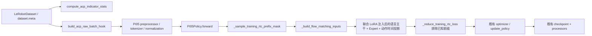
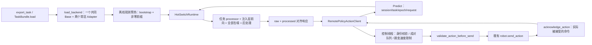

# π₀.₅ 热切换源码与环境审计

审计日期：2026-10-29（Asia/Shanghai）。工作目录 `E:\ABYT\EvoRL\Evo-RL`，分支 `training-RTC`，起始提交 `e9d277ae0650fb3fb7e991fcfa87399b20ce1a66`。起始 `git status --short` 为空。未 reset、clean、切换分支、改写 remote 或推送。

## 说明与输入

检查了 E:\、E:\ABYT、E:\ABYT\EvoRL、仓库及子目录，没有发现适用的 AGENTS.md。没有找到所述 `Codex_Fger23_EvoRL_HotSwitch_Prompt.md` 文件，因此按用户随消息附上的完整《Codex 实施任务》文本实施。仓库 remote `github` 指向 Fger23/Evo-RL；其他已有 remotes 保留。

真实源码从 `PYTHONPATH=src` 导入，模块位置为本仓库 `src/lerobot`，没有替换为其他分支或 pip 的 LeRobot。README、run.txt、d_run.txt 是现有命令证据；run.txt 包含 Linux `/nfs/…` 的历史训练路径，不能推定这些路径在 Windows 存在。

## 起始环境和可运行范围

| 项目 | 观察 |
|---|---|
| 项目 .venv | pyvenv.cfg 引用不存在的 D:\Miniconda3；原环境未修改 |
| 可用 Python | C:\Users\ROG\miniforge3\python.exe，3.13.13 |
| Torch / Transformers / PEFT | 2.12.0+cpu / 5.9.0 / 0.19.1；不在本仓库声明的完整兼容范围内 |
| Transformers provenance | 无 direct_url.json，未发现 π₀.₅ 所需自定义接口；不能锁定为兼容环境 |
| 协议 | grpcio 1.73.1；实际 protoc 工具隔离安装，未升级用户环境 |
| GPU 初查 | RTX 5080 Laptop 16 GB，约 9.2 GB 已占用，95% 利用率；未启动 GPU 工作 |
| Base | Hugging Face π₀.₅ 缓存仅有 refs/main，没有权重 blobs/snapshots |
| 任务数据 | 当前仓库和 EvoRL 父目录未找到任务 A/B 的真实数据集或 ACP 标注；未擅自选用其他缓存数据 |

独立测试 venv 位于本聊天工作目录的 `work/hotswitch-test-env`，使用 system-site-packages 复用现有 CPU 依赖。这只能用于离线工程测试，不是已验证的 π₀.₅ 依赖锁。环境原始 JSON 随交付报告保留。

## 真实调用链

训练已有组件：

符号定位：`scripts/lerobot_train.py:train` 调用 `policies/factory.py:make_policy` 和 `policies/pretrained.py:wrap_with_peft`；正式 ACP/TRC 入口 `scripts/lerobot_train_trc.py:validate_trc_training_config` 保留类型、最大延迟、ACP 校验。没有另写 Flow Matching 损失或替换 ACP 算法。

部署新增链路：

选择现有远程录制客户端作为主接入链路，因为它已服务 recording_loop 的人工接管与数据写入。`policy_server.py:ControlPolicy/Predict`、`hotswitch.py:HotSwitchRuntime`、`hotswitch_backend.py:ResidentBackend`、`recording_hotswitch.py:HotSwitchRecordingSession` 是新增能力。原来的 `SendPolicyInstructions` 只会加载完整模型，不能把训练 PEFT 视为部署已支持共享 Base。

旧通用 RobotClient 保持原默认连接行为，新增 robot/stub/channel 注入和 `connect_robot=False` 供无硬件测试。它仍是旧协议客户端，不能直接在注册表服务器上使用；服务器明确拒绝旧 setup。本地录制推理未改成多任务路由，保持原路径。没有加入 residual actor、critic 或 RLT 训练。

## RTC 与隔离边界

普通 action chunk 异步队列、legacy 梯度引导 RTC、Training-Time RTC 是三种不同路径。原来的 delay telemetry、weighted_average 和队列聚合不具备 clean-prefix 语义。

新增 TRC 路径携带归一化前缀，返回 raw 与 processed；π₀.₅ sampler 每个 flow step 对前缀 hard clamp，并将相应时间条件置零。新任务首请求无前缀，之后才使用当前任务成对队列中的 raw 前缀。按实际 acknowledge 的命令数裁剪响应，超出前缀覆盖范围保持并拒绝。legacy RTC 不进入这个新后端；原有入口保留，尚未完成真实 legacy RTC GPU 回归。

整个 forward、去噪、任务 processor 和 CPU 结果物化由同一服务端锁保护。任务激活只引用启动时加载的对象；切换路径没有 from_pretrained、load_adapter、merge、权重文件读取或 robot.connect。失败可回滚到一致旧状态；回滚也失败则 healthy=false。旧 session/epoch/request 的结果和错误不能进入新队列。控制线程提交切换，清理队列、pending、计数和 generation，等待在途请求退出后切换。幂等操作回复后再查询最终状态，避免超时后误认旧任务。

## 当前能力限制

单客户端、单活动任务、eager；不支持 modules_to_save、共享 bias 更新、DoRA、跨任务 raw-prefix 转换或 legacy RTC 组合。任务兼容检查拒绝结构、tokenizer、动作名称顺序单位或频率不匹配；各任务统计与 processor 分别保存并原子选用。

混合任务录制 episode 目前明确禁止切换，避免错误归属。episode 外可以切换；后续新 episode 使用当前任务文本和策略身份。真机热切换还要求已验证的 hold callback 和完整的跳变/速度限制，不能通过默认不发送动作来宣称安全保持。

代码机制、模拟测试与真实模型验收严格区分。没有真实 π₀.₅ 权重、兼容 CUDA 环境和 A/B 数据，因而未产生真实训练 Adapter、真实 GPU 性能、正式训练或真机成功率。
