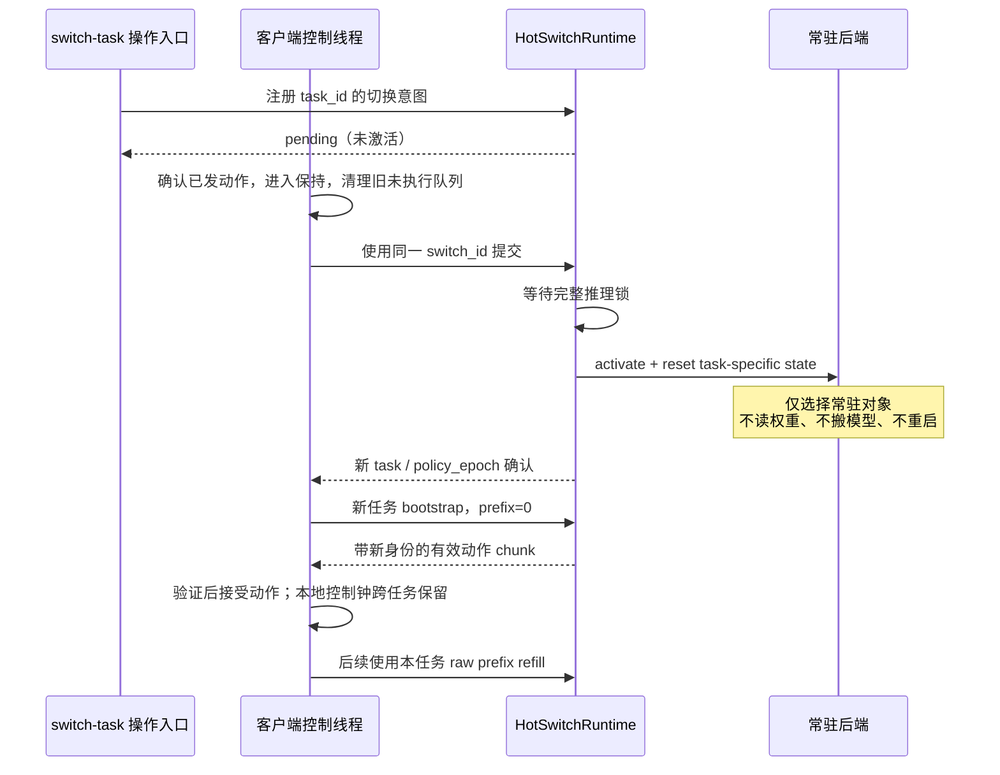

# 实际调用链与证据边界

本图对应当前 Fger23/Evo-RL 实施，任务 A 为整理纸币；A_copy 是相同权重的机制副本。
pilot 的价值模型 200 步、全量标签与联合 Adapter 200 步已经执行。
正式预算、第二任务训练、真机和 rollout 成功率未执行。

```mermaid
flowchart LR
  D["19 份注册数据<br/>291 episodes / 332523 frames"] --> V["lerobot_value_train<br/>pilot 200 步"]
  V --> I["lerobot_value_infer<br/>仅写独立 labeled_dataset"]
  I --> A["真实 value / advantage / indicator"]
  A --> T["lerobot_train_trc<br/>校验 pi05、ACP、正 RTC 训练延迟"]
  T --> H["build_acp_raw_batch_hook<br/>标签条件与 dropout"]
  H --> P["preprocessor<br/>状态归一化、任务文本、tokenizer"]
  P --> J["联合 PEFT 前向<br/>PaliGemma 语言 + FM Expert<br/>action / time 四投影"]
  B["共同 Base<br/>冻结参数 / 内容指纹"] --> J
  J --> L["原 Flow Matching loss<br/>clean prefix time=0<br/>已知前缀不监督"]
  L --> O["原 trainer / optimizer<br/>有限 loss 与梯度检查"]
  O --> C["checkpoint<br/>Adapter、processor、实际 tokenizer<br/>optimizer / RNG / scheduler"]
  C --> E["export_task<br/>Base 指纹、任务 schema、RTC/ACP<br/>离线观测与 tokenizer 资产"]
```

`verify_peft_base` 在实际加载状态之后开始审计，检查点发布前绑定保存文件的 SHA。
恢复须核对先前连续覆盖链；从已完成预算恢复而没有新更新时拒绝发布。
旧 pilot 没有全程 Base 哈希审计，导出明确为 `NOT_ENABLED`，不能补写历史证明。

```mermaid
flowchart LR
  R["受控 registry / manifest"] --> X["校验 Base、Adapter、tokenizer<br/>动作顺序/单位/频率、相机与结构"]
  X --> S["SharedAdapterBackend<br/>1 Base + 2 常驻 Adapter<br/>每任务独立 processor"]
  S --> W["HotSwitchRuntime.preload<br/>无前缀 + 实际非零前缀预热<br/>清除预热状态后 ready"]
  W --> G["PolicyServer<br/>版本化 hot-switch RPC"]
  Q["离线观测 + session/task/epoch/request<br/>accepted observation_step / raw prefix"] --> G
  G --> K["完整推理锁<br/>身份检查 → preprocess<br/>FM predict → postprocess"]
  K --> Z["响应<br/>raw / processed 配对动作 + 身份"]
  Z --> F["客户端核对身份、有限值<br/>前缀 hard clamp 与已消耗步数"]
  F --> U["配对队列 + 每个动作身份"]
  U --> N["next_action<br/>最小控制间隔 / 动作校验"]
  N --> M["模拟控制接口 send_action"]
  M --> C["confirm_action<br/>实际接受值一致后推进 accepted_steps"]
  C --> Q
  Z -->|"旧 epoch / 迟到响应或错误"| DROP["丢弃并计数<br/>不能进入新任务队列"]
```

`HotSwitchClientCore` 是远程录制热切换接入的状态核心；现阶段 refill 同步并进入保持。
普通异步队列、legacy 梯度 RTC 和 Training-Time clean prefix 是独立路径。
当前自动验收只使用离线观测及模拟控制器；真实驱动需要确认单位、限位和保持策略。

bf16 的两个独立未合并策略与 FP32 的两个合并完整模型是不同对照。
每个实验内两侧精度、输入和切换策略一致；它们的绝对速度与显存不能跨精度混比。
训练后首次 bf16 合并误差超限的证据保留，不能由后续 CPU 或 GPU 结果覆盖。
